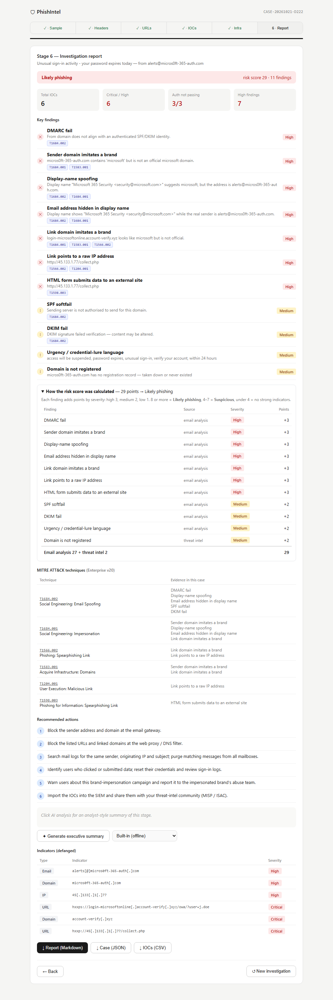
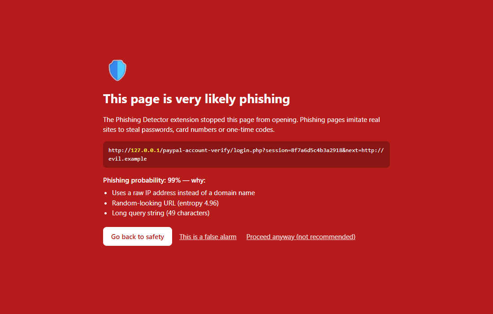
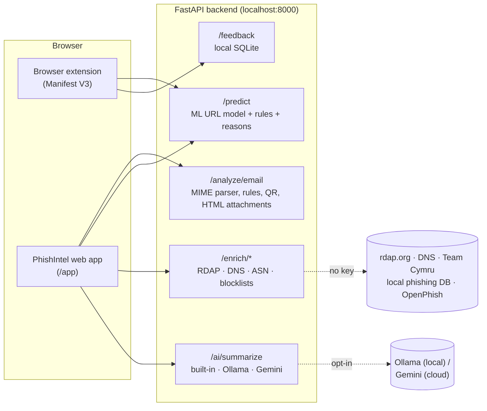
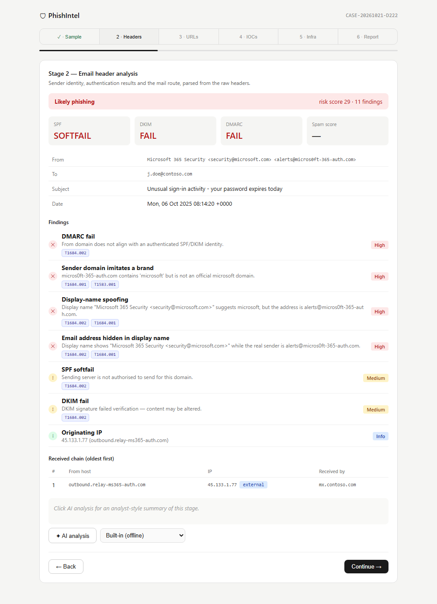
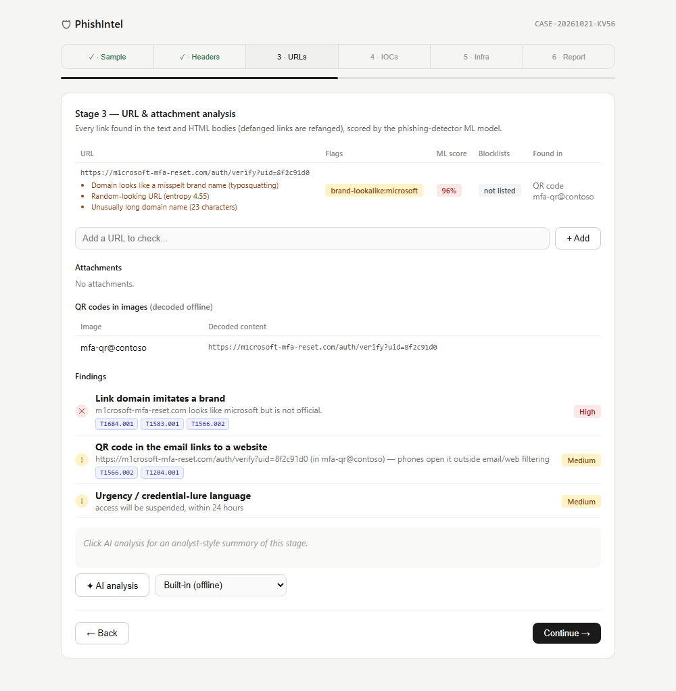
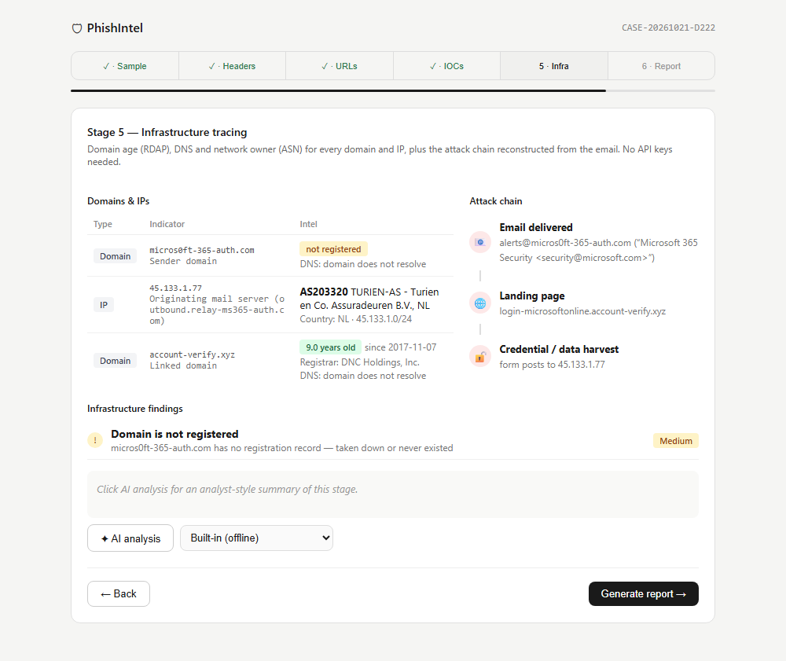
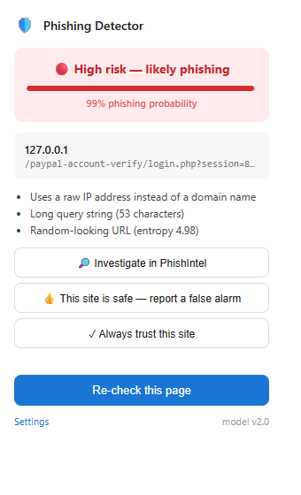

# PhishIntel: Phishing Detection & Investigation Toolkit

A final-year project that tackles phishing from two sides:

- **Prevention.** A **browser extension** scores every page you open with
  a machine-learning URL model, blocks likely phishing pages, and explains
  why.
- **Investigation.** **PhishIntel**, a web app for analysts, takes a
  suspicious email, pulls it apart, enriches every indicator with free
  threat intelligence, maps it to MITRE ATT&CK, and produces a report.

The application runs locally and **works without any API key**.

**Network lookups.** Some threat-intel enrichment does make network
requests:
- **rdap.org** receives the domain names being looked up (domain age).
- **Your DNS resolver** receives the domain names (DNS records).
- **Team Cymru** receives the IP addresses, through DNS queries (network
  owner).
- **OpenPhish:** the feed is downloaded as a whole. No URLs are sent.

These lookups never include email content. The URL model, email parsing,
QR decoding and the local blocklist all run offline.

**Optional services.** VirusTotal and URLhaus, if you add keys, receive the
URLs being checked. Cloud AI (Gemini) is optional and shows you exactly what
it would send before anything leaves the machine.

<p align="center">
  
  
</p>

## Architecture



More detail: **[docs/ARCHITECTURE.md](docs/ARCHITECTURE.md)**

## Features

**URL model** (`phishing-detector/backend`)
- **Model:** a Random Forest over 33 lexical features. It checks for brand
  typosquats (`paypa1`, `steamcommunlty`), punycode, free-hosting platforms,
  abused TLDs, URL structure and entropy.
- **Honest evaluation:** test domains are never seen in training, there are
  no leaked features, and the legitimate URLs are realistic. On held-out
  domains: **F1 0.955, 3.6% false alarms**. The original model looked like
  F1 0.995 but **flagged 75% of new legitimate pages**; see
  [docs/EVALUATION.md](docs/EVALUATION.md).
- **Explanations:** every verdict comes with up to 3 human-readable reasons.
- **Hybrid rules:** a trusted-domain cap, a brand-impersonation floor, and
  shortened links reported as "medium".

**Browser extension** (`phishing-detector/extension`)
- **High risk:** a full-page warning (go back / report / proceed anyway).
- **Medium risk:** a page banner.
- **Popup:** the reasons, report false alarm / phishing, trust this site,
  and *Investigate in PhishIntel*.
- **Permissions and privacy:** minimal permissions, and logging is opt-in.

**PhishIntel** (`phishintel`): six stages, from sample to report.
- **Email analysis:** SPF/DKIM/DMARC, sender spoofing, Received chain,
  links (including defanged ones), and link-text mismatch.
- **Hidden content:** HTML attachments are read as text, and QR codes in
  images are decoded ("quishing").
- **Free threat intel:** domain age, DNS, ASN, a local list of 784k phishing
  URLs, and OpenPhish.
- **Reporting:**
  - MITRE ATT&CK v20 mapping and a score breakdown.
  - Exports as Markdown, JSON or CSV, with indicators defanged.
  - AI summaries: built-in (offline), Ollama (local), or Gemini with
    redaction and a preview before sending.

## Screenshots

| | |
|---|---|
|  |  |
| **Stage 2:** sender identity, authentication, ATT&CK | **Stage 3:** link decoded from a QR code, ML score and reasons |
|  |  |
| **Stage 5:** domain age, ASN, attack chain | **Extension popup:** verdict, reasons, actions |

## Quick start (Windows)

Requires **Python 3.13**. Chrome or Edge is needed for the extension.

```bash
git clone https://github.com/Snouderr/PhishIntel.git
cd PhishIntel
python -m venv .venv
.venv\Scripts\activate
pip install -r phishing-detector/backend/requirements.txt

cd phishing-detector/backend
uvicorn api:app --port 8000
```

1. Open **http://localhost:8000/app/**, click a demo sample (e.g. *QR-code
   phishing*), then click **Analyze email**.
2. Load the extension: `chrome://extensions` → Developer mode → **Load
   unpacked** → `phishing-detector/extension/`.
3. Optional: copy `phishing-detector/backend/.env.example` to `.env` to
   enable Gemini, VirusTotal or URLhaus.
4. Optional: enable the offline blocklist of 784k phishing URLs. The lists
   are too large for git, so download them (instructions in
   [DATASETS.md](phishing-detector/data/DATASETS.md#phishingdatabase-archives-offline-blocklist--phishing-sample)):
   ```bash
   cd phishing-detector/data
   curl -LO https://phish.co.za/latest/ALL-phishing-links.tar.gz
   curl -LO https://phish.co.za/latest/ALL-phishing-domains.tar.gz
   ```

Run the tests (89, no network needed):

```bash
cd phishing-detector/backend
python -m pytest
```

## Repository layout

```
PhishIntel/
├── phishintel/              # investigation web app (HTML/CSS/JS, no build step)
│   └── samples/             # 6 demo emails (.eml), incl. quishing + HTML attachment
├── phishing-detector/
│   ├── backend/             # FastAPI API, ML model, email analysis, intel, AI
│   │   ├── tests/           # pytest suite
│   │   └── legacy_v1/       # original model, kept for the before/after comparison
│   ├── extension/           # Chrome / Edge extension (Manifest V3)
│   ├── data/                # training data (urls_v2.csv) + dataset docs
│   └── reports/             # evaluation metrics, figures, error lists
├── docs/                    # architecture, evaluation, demo script, screenshots
└── PLAN.md                  # phased roadmap and what was done in each phase
```

## Documentation

| Document | What's in it |
|---|---|
| [docs/ARCHITECTURE.md](docs/ARCHITECTURE.md) | Components, data flow, API reference, privacy and security design |
| [docs/EVALUATION.md](docs/EVALUATION.md) | Model evaluation: method, v1 vs v2, figures, error analysis, limitations |
| [docs/DEMO.md](docs/DEMO.md) | A 10-minute demo script for a presentation or viva |
| [phishing-detector/README.md](phishing-detector/README.md) | Backend, model and extension details; retraining |
| [phishing-detector/data/DATASETS.md](phishing-detector/data/DATASETS.md) | Data sources and how the v2 dataset is built |
| [PLAN.md](PLAN.md) | The project plan and progress by phase |

## Responsible use

The demo emails are fabricated. Their domains and IPs are for
demonstration only. Never open real phishing links in a normal browser;
PhishIntel reads attachments as text and never visits the links it finds.
