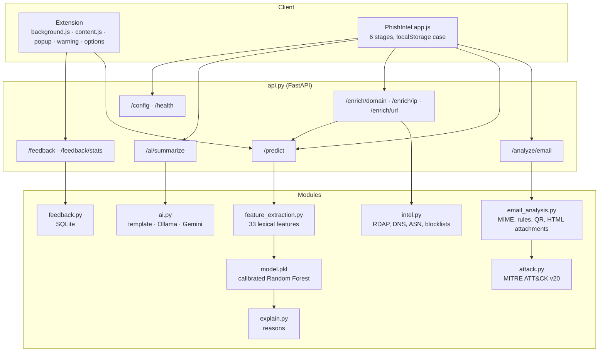

# Architecture

The system has three parts that talk to one local FastAPI backend:

| Part | Location | Technology |
|---|---|---|
| Backend API | `phishing-detector/backend/` | Python 3.13, FastAPI, scikit-learn, dnspython, httpx, OpenCV |
| Browser extension | `phishing-detector/extension/` | Chrome/Edge Manifest V3, plain JavaScript |
| PhishIntel web app | `phishintel/` | HTML/CSS/JavaScript (no build step), served by the backend at `/app` |

## Backend modules

| Module | Responsibility |
|---|---|
| `api.py` | HTTP endpoints, model loading (v1 and v2 formats), the rule layer around the model (trusted-domain cap, brand-impersonation floor, shortener → medium), risk bands, and serving `/app` |
| `feature_extraction.py` | 33 model features from the URL text alone. Two more (`is_trusted_domain`, `is_restricted_tld`) are computed for the rule layer only and kept out of the model to avoid label leakage. |
| `brands.py` | Shared reference data: impersonated brands and their real domains, free-hosting platforms, abused TLDs, leetspeak maps, edit distance |
| `explain.py` | Per-verdict reasons. Each feature is reset to the typical legitimate value and the change in log-odds is measured. |
| `train_model.py` | Domain-grouped training and evaluation, figures, and the comparison against v1 (see [EVALUATION.md](EVALUATION.md)) |
| `build_dataset.py` | Builds `data/urls_v2.csv` from site sitemaps, Common Crawl and Phishing.Database |
| `email_analysis.py` | Parses a raw email using the stdlib `email` package only. Covers headers, SPF/DKIM/DMARC, the Received chain, links (text, HTML, form actions, defanged), HTML attachments read as text, QR codes decoded with OpenCV, the rules, the verdict and the IOCs. |
| `attack.py` | Maps each finding to MITRE ATT&CK Enterprise v20 techniques (IDs verified on attack.mitre.org) |
| `intel.py` | Lookups that need no key: RDAP domain age, DNS (A/MX/NS/SPF/DMARC), Team Cymru ASN over DNS, the local Phishing.Database list in SQLite, and the OpenPhish feed. URLhaus and VirusTotal are used only if their keys are set. Results are cached for 6 hours and failures are returned as `{"error": …}`. |
| `ai.py` | Summaries from the built-in template (offline), Ollama (local) or Gemini (cloud). Only derived facts are sent, recipient data is redacted, and a dry-run returns the exact prompt. Gemini handling includes retries, model fallback, and filtering out reasoning ("thought") parts. |
| `feedback.py` | Local SQLite store for user reports and opt-in check logs, with export to a relabelling CSV |

## API reference

All endpoints are on `http://localhost:8000`. Interactive docs are at `/docs`.

| Method & path | Body → response | Used by |
|---|---|---|
| `GET /health` | → `{status, model_loaded, model_version}` | extension settings |
| `GET /config` | → which AI providers and intel sources are available, plus the ATT&CK catalogue | PhishIntel |
| `POST /predict` | `{url, log?, source?}` → `{is_phishing, phishing_probability, risk_level, trust_override_applied, reasons[], model_version}` | extension, PhishIntel |
| `POST /analyze/email` | `{raw}` (max ~10 MB) → `{headers, auth, hops, urls, attachments, html_attachments, qr_codes, findings[], verdict, iocs, attack}` | PhishIntel |
| `POST /enrich/domain` | `{domain}` → `{rdap: {registered, age_days, registrar…}, dns: {a, mx, ns, spf, dmarc}}` | PhishIntel stage 5 |
| `POST /enrich/ip` | `{ip}` → `{asn, as_name, prefix, country, ptr}` (private IPs → `{private: true}`) | PhishIntel stage 5 |
| `POST /enrich/url` | `{url}` → `{ml, blocklists: {local, openphish, listed}, urlhaus, virustotal}` | PhishIntel stage 3 |
| `POST /ai/summarize` | `{kind, case, provider, redact, dry_run}` → `{text, provider, model}` or `{prompt}` (dry run) | PhishIntel |
| `POST /feedback` | `{url, label, risk_level?, probability?, …}` → `{ok, id}` | extension |
| `GET /feedback/stats` | → counts per label and per logged risk level | — |

## How a URL is scored

1. `extract_features(url)` produces 33 numbers. No network call is made.
2. The calibrated model returns a phishing probability.
3. Rules then adjust it:
   - **Trusted domains** (Tranco top 300k, or restricted `bank.in` / `gov.in`)
     are capped at 5%. Free-hosting platforms and shorteners are never capped.
   - **Brand impersonation** (typosquat, a brand used as a subdomain, a brand
     name on a domain the brand doesn't own, punycode) is floored at 0.9.
   - **Shortened / QR links** are set to "medium", because their text can't
     show the destination.
4. **Risk band.** The model's threshold (0.786) sets the bands: *medium*
   from the threshold up to halfway to 1, *high* above that, *low* from half
   the threshold, *safe* below.
5. **Reasons:** up to 3. Rule reasons come first, then the model features
   that pushed the score up most.

## How an email is scored

`email_analysis.analyze_email` produces findings with a severity, and
each severity is worth points: high 3, medium 2, low 1, info 0.

- **The email's own verdict:** 8 or more points = *Likely phishing*, 4–7 =
  *Suspicious*.
- **Combined verdict:** PhishIntel adds its threat-intel findings (domain
  age, blocklist hits, VirusTotal) to that score and applies the same
  thresholds.
- **In the report:** the score breakdown lists every point, and each finding
  carries its ATT&CK techniques.

## Privacy and security design

- **Keyless by default.** Nothing needs an account or API key. Gemini,
  VirusTotal and URLhaus switch on only if a key is in `backend/.env`, which
  is git-ignored and never sent to the browser.
- **Cloud AI is opt-in and reviewed.**
  - The email body is never sent.
  - Recipients, their names and URL parameters are redacted by default.
  - The exact prompt is shown for confirmation before every Gemini request.
- **Nothing suspicious is executed.**
  - Links in emails are never visited.
  - HTML attachments are parsed as text.
  - QR codes are decoded from image bytes.
- **No HTML injection.**
  - PhishIntel escapes every value and uses `data-action` event delegation,
    with no inline handlers.
  - The extension builds its UI with DOM APIs.
  - The page banner lives in a closed shadow root.
- **Minimal extension permissions:** `tabs`, `storage`, `webNavigation`, and
  the local API. A custom API address is requested only when you set one.
  Access to all websites is never requested.
- **Opt-in logging.** URL logging is off by default, because it amounts to
  browsing history. Feedback and logs stay in `data/feedback.sqlite`
  (git-ignored).
- **Fail-safe defaults.** If the API is down, the extension lets browsing
  continue rather than blocking it. A failing lookup returns an error and
  doesn't break the investigation.
