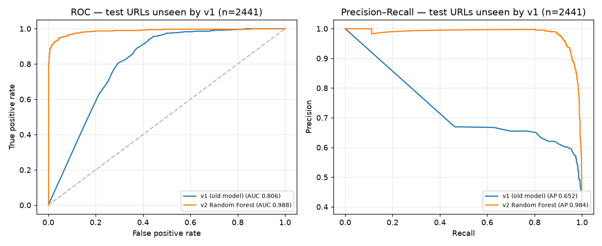
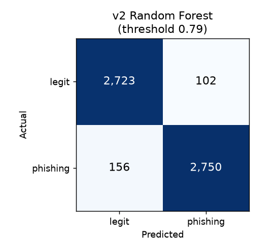
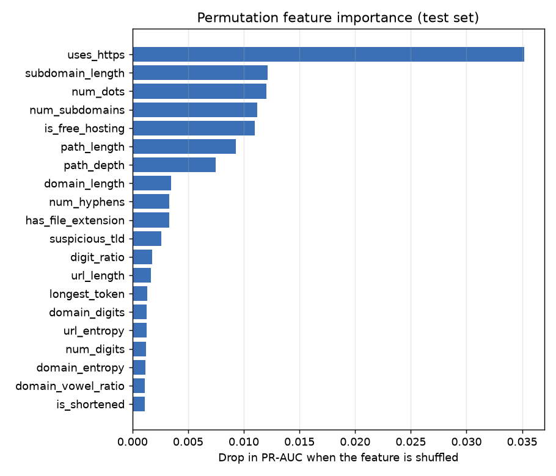

# Evaluation of the phishing URL model

**Summary.** The original model (v1) reported **F1 0.995**, but that number
came from a flawed evaluation. On realistic URLs it had never seen, it
flagged **75% of legitimate pages as phishing**. The rebuilt model (v2)
keeps the false-alarm rate on the same unseen URLs to **6.3%**, and scores
**F1 0.955 with a 3.6% false-alarm rate** on a held-out set of domains it
never saw in training.

All numbers below come from `phishing-detector/reports/metrics.json`
(model trained 2026-10-20). `python train_model.py` reproduces them in
about 4 minutes.

## 1. Problems found in the original evaluation

The audit of the v1 setup (`data/urls.csv`, 27,942 URLs: 10,000 phishing
and 17,942 legitimate) found three problems:

| Problem | Evidence | Why it inflates the score |
|---|---|---|
| **Label leakage** | The legitimate URLs came from the Tranco top-sites list, the same list behind the `is_trusted_domain` feature. 97.6% of legitimate URLs were "trusted", against 67.2% of phishing URLs. | The model can learn "on the list = legitimate" rather than what phishing looks like. |
| **Shortcut learning** | 67% of legitimate URLs were bare homepages (`https://site.com/`), against 37% of phishing URLs. Every legitimate URL used HTTPS. | "Has a path" or "no HTTPS" becomes a proxy for phishing, which fails on real browsing (mostly deep links). |
| **Random train/test split** | The same domain appeared on both sides of the split. | The model is rewarded for memorising domains. |

Changing only the evaluation, with the same data and a Random Forest:

| Setup | F1 |
|---|---|
| Random split, all features (as originally reported) | 0.995 |
| Split by domain, all features | 0.992 |
| Split by domain, without `is_trusted_domain` | 0.965 |

These numbers still flatter the model, because the test set shares the
homepage bias. The real gap only appears on realistic legitimate URLs
(§4).

## 2. The v2 dataset

`data/urls_v2.csv` has 28,868 URLs and is built by `backend/build_dataset.py`.
No API keys were needed. Details are in
[DATASETS.md](../phishing-detector/data/DATASETS.md).

| Source | Label | Rows | What it adds |
|---|---|---:|---|
| `tranco-home` | legitimate | 7,000 | homepages (down-sampled from v1) |
| `deep-link` | legitimate | 4,751 | real deep links from the `sitemap.xml` of ~2,500 domains, sampled across all Tranco rank bands |
| `cc-platform` | legitimate | 2,117 | legitimate pages on 16 free-hosting platforms (GitHub Pages, Google Sites, Weebly, Wix, Vercel…), from Common Crawl, max 6 per site |
| `orig-phish` | phishing | 10,000 | phishing URLs from v1 |
| `phishdb` | phishing | 5,000 | Phishing.Database sample (list date 2026-09-25), max 3 per host |

Any "legitimate" URL found in the phishing database was dropped.

## 3. Method

- **Features:** 33, all computed from the URL text. The 17 new ones cover
  brand typo distance and typosquats, a brand name in a subdomain or path,
  punycode, free hosting, abused TLDs, path depth, file extension, embedded
  URL, entropy, and token length. List-membership features stay out of the
  model and live in the API's rule layer only.
- **Splits by domain:** URLs are grouped by registered domain. On shared
  platforms (github.io, shorteners, google.com) each host is its own group.
  - The held-out test set is 20% of the groups: 5,731 URLs, used once, at
    the end.
  - Model selection uses 5-fold `StratifiedGroupKFold` on the remaining
    23,137 URLs.
- **Models compared:** Logistic Regression, Random Forest, and Histogram
  Gradient Boosting. Gradient Boosting is in the same family as XGBoost
  and needs no extra dependency.
- **Calibration:** sigmoid (`CalibratedClassifierCV`) on the **model's raw
  output**, so a raw score of "80%" means roughly that. `/predict`'s
  `phishing_probability` is that same calibrated value **unless a rule
  fired**. In that case it is rule-adjusted and is no longer a calibrated
  probability:
  - `trust_override_applied: true` means the trusted-domain cap set it to at
    most 0.05;
  - a `rule:brand_impersonation` reason means it was raised to at least 0.9;
  - a `rule:shortener` reason means it was set to the threshold.

  All metrics in this document use the raw calibrated model output, with
  no rules applied.
- **Decision threshold:** the threshold with the best F1 among those keeping
  **precision ≥ 97%** on out-of-fold training predictions. It came out at
  **0.786**. In a browser extension, false alarms cost the most, because
  they are what make people uninstall it.
- **Fair comparison with v1:** v1 was trained on `urls.csv`, so test rows
  taken from that file are ones it has already seen. The head-to-head below
  therefore uses only the **2,441 test URLs that neither model trained on**.

## 4. Results

### Model selection (5-fold group CV, training set)

| Model | Precision | Recall | F1 | PR-AUC | False-positive rate |
|---|---:|---:|---:|---:|---:|
| **Random Forest** (selected) | 0.960 | 0.933 | **0.946** | **0.988** | 4.2% |
| Hist Gradient Boosting | 0.956 | 0.933 | 0.945 | 0.987 | 4.7% |
| Logistic Regression | 0.906 | 0.874 | 0.890 | 0.959 | 9.9% |

### Held-out test set (5,731 URLs, domains never seen in training)

| Accuracy | Precision | Recall | F1 | ROC-AUC | PR-AUC | False-positive rate |
|---:|---:|---:|---:|---:|---:|---:|
| 0.955 | 0.964 | 0.946 | **0.955** | 0.990 | 0.991 | **3.6%** |

| | Predicted legitimate | Predicted phishing |
|---|---:|---:|
| **Actually legitimate** (2,825) | 2,723 | 102 |
| **Actually phishing** (2,906) | 156 | 2,750 |

### v1 vs v2 on URLs neither model trained on (2,441)

| | v1 (original) | v2 |
|---|---:|---:|
| Precision | 0.474 | **0.912** |
| Recall | 0.993 | 0.955 |
| F1 | 0.641 | **0.933** |
| PR-AUC | 0.652 | **0.984** |
| **False-positive rate** | **75.3%** | **6.3%** |

v1's near-perfect recall comes from flagging almost everything that isn't
a bare homepage.

### Accuracy by source (held-out test set)

| Source | Rows | v1 | v2 |
|---|---:|---:|---:|
| Legitimate pages on hosting platforms | 405 | **0.0%** | 96.8% |
| Legitimate deep links | 1,046 | 34.3% | 92.5% |
| Legitimate homepages | 1,374 | 100% | 99.2% |
| Phishing (original set) | 1,916 | 100%* | 94.2% |
| Phishing (new sample) | 990 | 99.3% | 95.5% |

\* v1 trained on these rows, so its score here is not a fair measure.

### Figures

| ROC / precision–recall: v1 vs v2 | Confusion matrix | Feature importance |
|---|---|---|
|  |  |  |

The most important features (measured as the drop in PR-AUC when a feature
is shuffled) are: HTTPS use, subdomain length, number of dots, number of
subdomains, and whether the page is on a free-hosting platform. These are
structural properties of how a phishing URL is built, rather than which
list a domain is on.

## 5. Error analysis

The full lists are in `reports/errors_false_positives.csv` (102 rows) and
`reports/errors_false_negatives.csv` (156 rows).

**Missed phishing (false negatives).** Most are phishing pages **hosted on
legitimate services**, whose URLs look harmless:
- QR-code landing pages on `flowcode.com/page/…`
- form builders (`abcsubmit.com`, `powr.io`)
- `linkedin.com/slink` redirects
- bare homepages such as `https://boig.at`

A model that only reads the URL can't separate these from legitimate pages
on the same service. That is why the system also uses blocklists, the email
analysis (sender spoofing, credential forms, QR codes) and user reports.

**False alarms (false positives).** Mostly URLs with **long random-looking
identifiers**:
- UUIDs (`service-public.fr/…/3454d232-3e67-…`)
- question IDs (`teratail.com/questions/4hvdw1gbyzx2rt`)

These resemble the random tokens in phishing URLs. In the extension, the
trusted-domain cap and the per-user "trust this site" list soften this.

The lists were **not** tuned with these specific domains. Doing so would
fit the test set and make the numbers dishonest.

## 6. Limitations and threats to validity

- **URL-only signal.** The model never fetches the page, so content-based
  phishing on reputable hosts is out of reach (see §5).
- **Concept drift.** Phishing feeds are a snapshot (list date 2026-09-25),
  and campaigns change quickly. The model should be retrained periodically.
  `feedback.py export` turns user reports into relabelling material.
- **Label noise.** A Tranco rank does not guarantee a site is benign (a few
  ranked sites are spam or piracy). Some phishing URLs in public feeds may
  be mislabelled.
- **Sampling bias.** The legitimate deep links come from sites that publish
  sitemaps (about 35% of those tried), and Common Crawl lists URLs
  alphabetically. Both are mitigated by sampling across rank bands and
  capping pages per host.
- **Only one held-out split.** The CV results (F1 0.946) and the held-out
  results (F1 0.955) agree closely, which suggests the estimate is stable.
  Repeated group splits would give confidence intervals.
- **Rules are evaluated separately.** The figures above are for the model
  alone. The API's rules (trusted-domain cap, brand-impersonation floor,
  shortener handling) change some individual verdicts; their behaviour is
  covered by unit tests rather than by these metrics.
